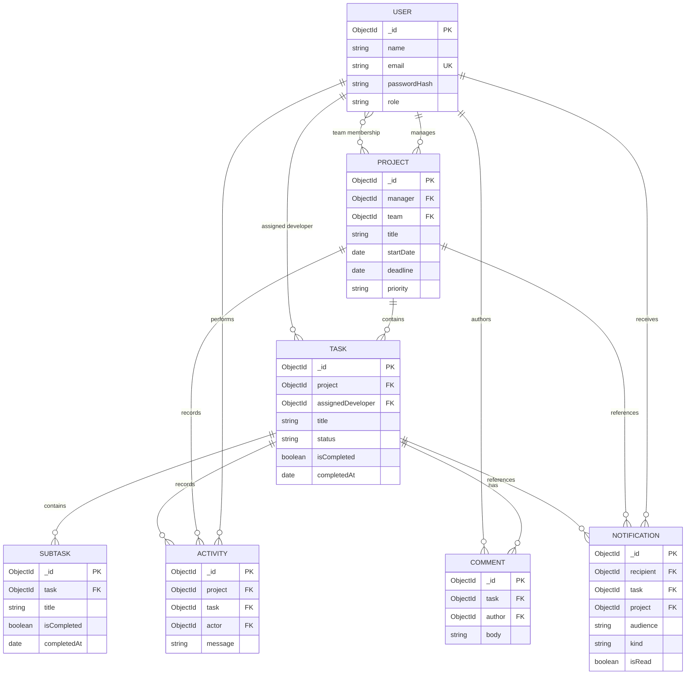

# Data Relationships

## Entity relationship diagram

The diagram shows logical relationships represented by ObjectId fields. These are not relational-database foreign keys. MongoDB does not automatically prevent a referenced document from being deleted.

## What each relationship means

### User and Project

- `Project.manager` stores one `User` ObjectId.
- `Project.team` stores an array of `User` ObjectIds.
- The manager relationship is logically one user to many projects.
- Team membership is logically many-to-many: one user can belong to many project teams, and one project can contain many users.
- Mongoose knows the referenced model because the schema uses `ref: "User"`.
- Mongoose does not enforce that the user exists. The project service validates team IDs and verifies that they belong to users with role `developer`.

### Project and Task

- `Task.project` stores one required `Project` ObjectId.
- A project can contain many tasks.
- `Task.findById`, `Task.find`, and explicit `.populate("project")` are used by services.
- Deleting a project triggers application-level cascade deletes for its tasks and related records in [`project.service.ts`](../src/services/project.service.ts).

### User and Task

- `Task.assignedDeveloper` stores one optional `User` ObjectId.
- A task can be unassigned.
- The task service checks that an assignee exists, has role `developer`, and is in the project team.
- Removing a developer from a project team unassigns that developer from open tasks in the project. This is application logic, not MongoDB referential integrity.

### Task and Subtask

- `Subtask.task` is a required ObjectId reference to `Task`.
- A task has many subtasks.
- The field has an index for task-based lookups.
- Deleting a task deletes its subtasks through [`task.service.ts`](../src/services/task.service.ts).

### Task and Comment

- `Comment.task` is a required ObjectId reference to `Task`.
- `Comment.author` references `User`.
- A task has many comments and a user can author many comments.
- Deleting a task deletes its comments.

### Notifications

Notifications can be:

- private: `recipient` contains a user ObjectId;
- role-wide: `recipient` is `null` and `audience` is `"manager"` or `"developer"`;
- general: both `recipient` and `audience` are `null`.

`task` and `project` are optional context references. Notification visibility is implemented in [`notification.service.ts`](../src/services/notification.service.ts), which filters by recipient and role audience.

### Activity

Activity records optionally reference a project, task, and actor. This allows:

- project-level events;
- task-level events;
- user registration events with only an actor;
- events without a related project or task.

The activity service populates `actor` when returning activity records.

## Enforcement summary

| Relationship or rule | Mongoose schema | Service/application code |
|---|---:|---:|
| Required ObjectId field is present | Yes | Also checked by service lookups |
| Referenced document exists | No | Yes, where the service explicitly loads it |
| User is a developer before assignment | No | Yes |
| Developer belongs to project team | No | Yes |
| Only assigned developer or owning manager edits subtasks | No | Yes |
| Removing a team member unassigns open tasks | No | Yes |
| Project deletion cascades related records | No | Yes |
| Task deletion cascades related records | No | Yes |
| Unique user email | Yes, via `unique: true` index | Duplicate-key error becomes HTTP 400 |

## Deletion behavior

The current application-level cascade rules are:

1. Deleting a project deletes its subtasks, comments, tasks, activities, notifications, and finally the project.
2. Deleting a task deletes its subtasks, comments, activities, notifications, and finally the task.
3. Deleting a user does not have a documented cascade service. Existing references may therefore require explicit cleanup if user deletion is introduced.
