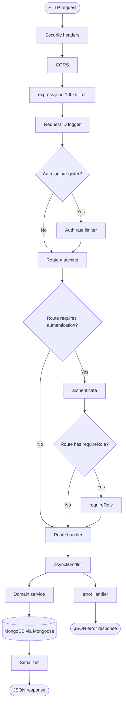
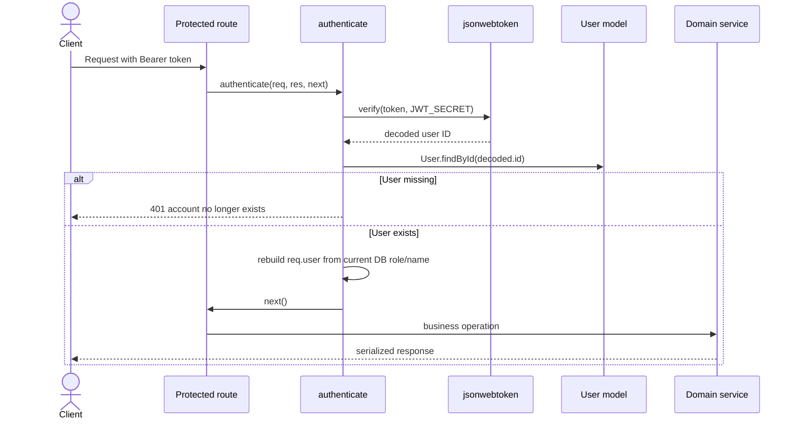
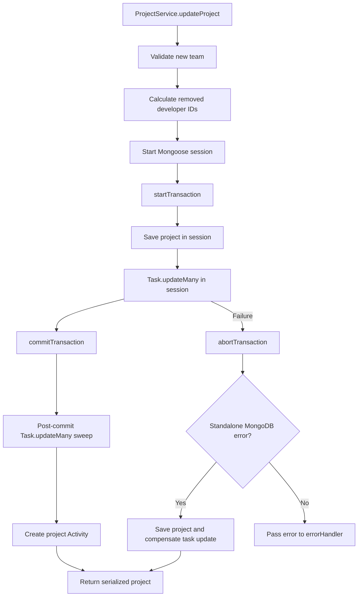

# Request Lifecycle

## Application pipeline

The Express application is assembled in [`app.ts`](../src/app.ts). The server is started separately by [`server.ts`](../src/server.ts).



## Middleware order

The actual order in [`app.ts`](../src/app.ts) is:

1. `securityHeaders`
2. CORS
3. `express.json({ limit: "100kb" })`
4. `requestLogger`
5. auth rate limiter for login and registration
6. domain routers
7. test-only barrier router when `NODE_ENV === "test"`
8. public health endpoints
9. `errorHandler`

The error handler must remain last so it can receive errors passed by `asyncHandler` and body parsing.

## Authentication



Missing, malformed, expired, or invalid tokens return 401. `requireRole` performs a coarse role check after authentication. Resource ownership and assignment checks happen in services because they require loading the target resource.

## Validation and errors

Validation is split across layers:

- Express JSON parsing rejects bodies over 100 KB.
- Route code extracts request values and passes them to services.
- Services validate business requirements and ObjectId formats.
- Mongoose validates schema-level required fields and enum values.
- `errorHandler` maps known errors to `{ message }`.

Known error mappings in [`middleware/error.ts`](../src/middleware/error.ts):

| Error | HTTP status |
|---|---:|
| Mongoose `CastError` | 400 |
| Mongoose `ValidationError` | 400 |
| Mongo duplicate key | 400 |
| `AppError` with status | That status |
| Oversized body | 413 |
| Unknown error | 500 |

## Example Task request

```text
POST /api/tasks
  → securityHeaders
  → cors
  → express.json
  → requestLogger
  → tasksRouter.post("/")
  → authenticate
  → requireRole("manager")
  → asyncHandler
  → taskService.createTask
  → Project/Task/User database operations
  → Activity and Notification writes
  → serializeTask
  → 201 JSON
```

## Transactions

Most routes do not start a database transaction. Project team removal is the important exception:



If the post-commit sweep fails, the current implementation logs the failure and still returns the project update. This is verified current behavior and is also an audit concern.

## Startup and shutdown

```text
index.ts
  → startServer()
  → connectDB()
  → app.listen(PORT)
  → setupGracefulShutdown(server)
```

Shutdown handles SIGINT, SIGTERM, unhandled rejections, and uncaught exceptions. It closes the HTTP server and then the Mongoose connection, with a ten-second force-exit timer.
