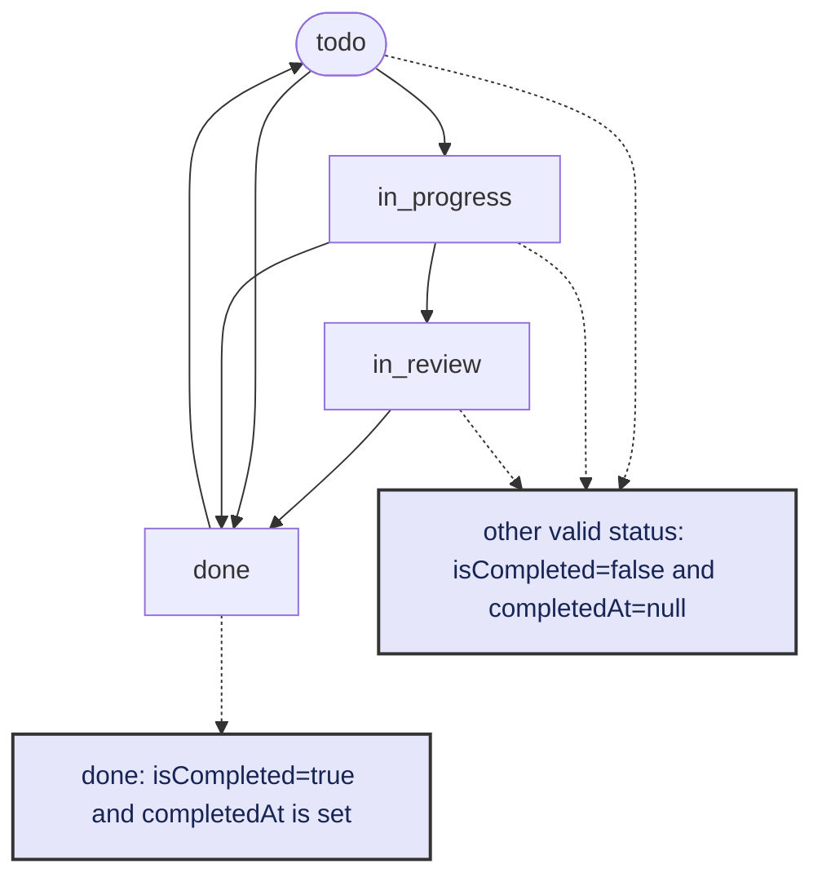
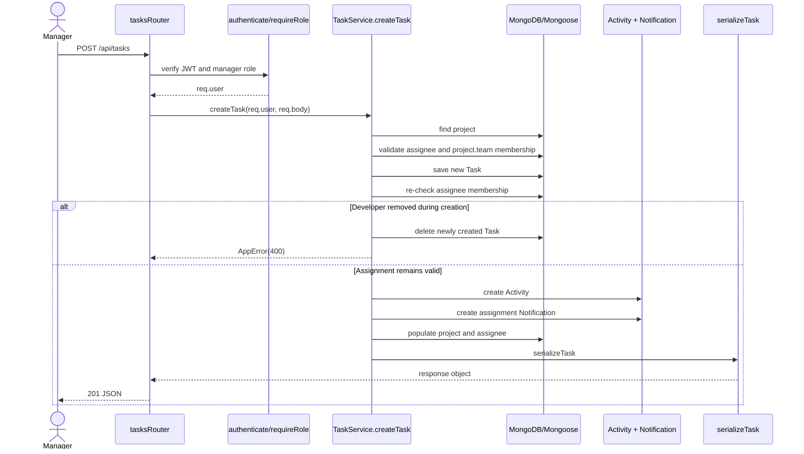
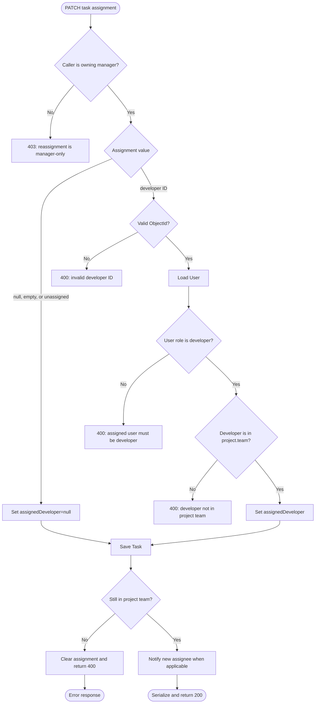
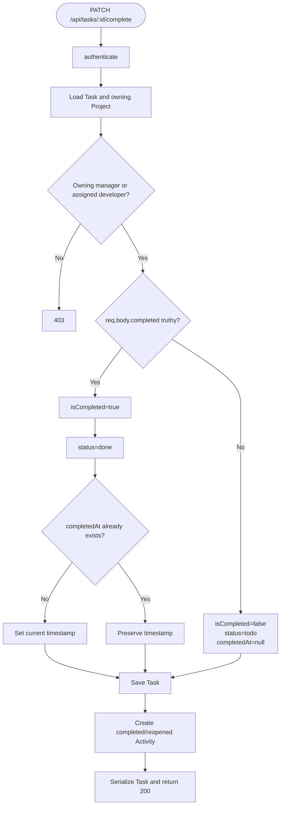
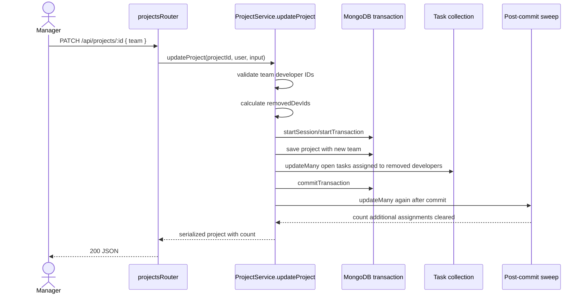

# Task Lifecycle

The main Task implementation is [`server/src/services/task.service.ts`](../src/services/task.service.ts). Routes are in [`server/src/routes/tasks.ts`](../src/routes/tasks.ts), persistence is defined in [`server/src/models/Task.ts`](../src/models/Task.ts), and responses are created by [`server/src/serializers/task.serializer.ts`](../src/serializers/task.serializer.ts).

## Task state

The model stores both a workflow status and completion fields:

| Field | Meaning |
|---|---|
| `status` | `"todo"`, `"in_progress"`, `"in_review"`, or `"done"` |
| `isCompleted` | Boolean completion flag used by API filtering and metrics |
| `completedAt` | Timestamp set when completing and cleared when reopening |

`applyTaskWorkflowState` in [`task.service.ts`](../src/services/task.service.ts) keeps these fields synchronized.



The status transition diagram represents the behavior accepted by `applyTaskWorkflowState`; there is no separate state-machine library.

## Create a task



Important behavior:

1. Only a manager can create a task at the route level.
2. The manager must own the selected project.
3. A supplied developer must exist, have role `developer`, and be in `Project.team`.
4. A second membership check protects against a developer being removed during creation.
5. Activity and assignment notification writes happen after the Task write. They are not in the same transaction as the Task creation.

## List and read

```text
GET /api/tasks
  → authenticate
  → TaskService.getTasks(req.query)
  → build MongoDB filter
  → Task.find(filter)
  → populate project and assignedDeveloper
  → sort by deadline
  → serializeTask for each document
  → 200 JSON array
```

Supported query filters include `project_id`/`projectId`, `assigned_to`/`assignedTo`, `priority`, `status`, `is_completed`, and `search`. Search text is escaped by [`escapeRegex`](../src/lib/utils.ts).

`GET /api/tasks/:id` validates the ObjectId, reads the task, populates project and assignee, and serializes one task. Missing or malformed task IDs return a 404 `AppError`.

## Update fields

`PATCH /api/tasks/:id` calls `TaskService.updateTask`.

| Caller | Allowed behavior |
|---|---|
| Owning project manager | Update task fields, assignment, and workflow state |
| Assigned developer | Update workflow state; cannot reassign or edit manager-controlled fields |
| Unassigned developer | Rejected |
| Manager of another project | Rejected |

The service:

1. loads the task;
2. checks the caller against the task and project;
3. validates a new assignee if assignment was supplied;
4. mutates manager-controlled fields when the caller is the manager;
5. applies workflow state;
6. saves the task;
7. re-checks team membership for a new assignment;
8. creates an activity event;
9. notifies a newly assigned developer;
10. reloads and serializes the task.

## Assign and unassign



Unassignment preserves the Task. It does not delete the Task or create a dedicated unassignment notification.

## Complete and reopen



The implementation uses `Boolean(completed)`. Therefore a string such as `"false"` is currently truthy; input behavior for non-boolean values is an unresolved validation concern documented in the audit.

## Subtasks

Routes are in [`subtasks.ts`](../src/routes/subtasks.ts) and business rules are in [`subtask.service.ts`](../src/services/subtask.service.ts).

- Create: validate title, load Task and Project, authorize owning manager or assigned developer, create Subtask, create Activity, serialize.
- Update: authorize through the parent Task and Project, update title and/or completion, set `completedAt`, notify manager when completed, serialize.
- Delete: authorize through the parent Task and Project, then delete the Subtask.

The parent Task is not automatically completed when all subtasks are complete.

## Comments

Routes are in [`comments.ts`](../src/routes/comments.ts) and business rules are in [`comment.service.ts`](../src/services/comment.service.ts).

- Create: validate body, load Task, create Comment, create Activity, notify the assigned developer when appropriate, broadcast a manager notification, reload with populated author, serialize.
- Delete: the author may delete; a manager may delete only when they own the task's project.

## Remove a developer from a project team



The service uses a transaction when supported. Its fallback path handles standalone MongoDB by saving the project and compensating if task unassignment fails. The post-commit sweep is best-effort and currently logs a failure instead of changing the successful response.

Only tasks satisfying all of these conditions are unassigned:

- they belong to the project;
- their `assignedDeveloper` is one of the removed developers;
- `isCompleted` is `false`.

Completed tasks preserve their assignment history.

## Concurrency and failure paths

- Project documents use Mongoose `optimisticConcurrency`.
- Task documents do not currently enable optimistic concurrency.
- Task creation and assignment use a second membership check to detect team removal races.
- Project team removal uses MongoDB transactions where available.
- `concurrencyTestBarriers` makes race scenarios deterministic in tests.
- Activity and notification writes are separate from most core entity writes.
- Task deletion performs sequential cascade deletes rather than one transaction.

Relevant tests are in [`characterization.test.ts`](../test/characterization.test.ts), [`concurrency.test.ts`](../test/concurrency.test.ts), and [`subtask-authorization.test.ts`](../test/subtask-authorization.test.ts).

## Activity events

Task-related activity messages currently include:

- `created task <title>`
- `updated task <title>`
- `moved <title> to <status>`
- `completed <title>`
- `reopened <title>`
- `added subtask "<title>"`
- `added a comment`

